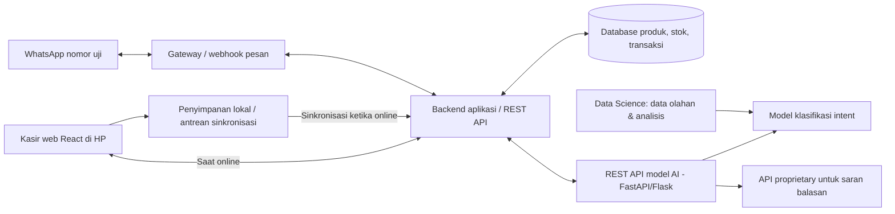

# Sistem Nota Digital & Chatbot Toko Indo Telur

> Capstone Project Asah 2026 · Tim **A26-CS201** · **Status: perencanaan / pengembangan MVP**

Sistem Nota Digital & Chatbot Toko Indo Telur adalah rancangan aplikasi kasir berbasis web untuk membantu usaha grosir sembako di Kota Bontang membuat nota lebih cepat, mengelola produk dan stok, serta memberikan respons awal terhadap pesan pelanggan. Aplikasi direncanakan dapat digunakan di browser HP Android, termasuk untuk pencatatan transaksi saat koneksi internet tidak tersedia.

**Dokumentasi kebutuhan lengkap:** [Product Requirements Document (PRD)](./PRD.md). **Dokumentasi database:** [Database Schema](./docs/database-schema.md).

> **Catatan status:** Fitur di bawah adalah **ruang lingkup yang direncanakan dalam Project Plan**, bukan klaim bahwa fitur sudah diimplementasikan, diuji, atau tersedia secara publik. MVP ini ditujukan untuk demonstrasi dan validasi UMKM, bukan langsung untuk operasional produksi.

## Status implementasi saat ini

Fondasi backend dan database telah tersedia untuk tahap berikutnya:

- Backend menggunakan Node.js, Express, dan driver `pg`; endpoint `GET /api/health` serta `GET /api/db-check` telah diuji.
- PostgreSQL memiliki migration idempoten untuk `products`, `transactions`, `transaction_items`, `stock_movements`, dan `sync_records`.
- Harga dan total memakai `NUMERIC`; skema nota menyediakan snapshot produk/harga; perubahan stok dicatat secara immutable dan tidak dapat menghasilkan stok negatif.
- Migration dan constraint database telah diverifikasi terhadap database `toko_indo_telur`; data uji selalu di-rollback.

Product API untuk membaca, menambah, memperbarui, dan menghapus produk secara aman sudah tersedia. Endpoint transaksi, sinkronisasi frontend, chatbot, cetak, dan fitur offline **belum diimplementasikan**. Detail ERD, constraint, dan cara menjalankan database tersedia di [Database Schema](./docs/database-schema.md).

## Latar belakang

Toko Indo Telur menjual sembako secara grosir kepada pemilik toko dan pedagang eceran. Pesanan diterima melalui WhatsApp maupun langsung di gudang. Selama ini pemilik menghitung pesanan dan menulis nota secara manual; ketika chat ramai, respons dapat terlambat dan nota terkadang baru siap menjelang pengantaran.

Proyek ini berfokus pada digitalisasi nota sekaligus mempertahankan rencana tim untuk manajemen stok, sinkronisasi data, dan chatbot WhatsApp. Perluasan tersebut tetap memerlukan konfirmasi kesesuaian dengan UMKM dan Tim Asah.

## Tujuan

- Memudahkan pemilik membuat nota penjualan yang akurat, tersimpan, dan siap sebelum pengantaran.
- Menyediakan pengelolaan produk, harga, stok, dan riwayat transaksi.
- Memungkinkan kasir bekerja secara lokal saat offline, kemudian menyinkronkan transaksi ketika online.
- Mendukung cetak nota di printer Bluetooth milik toko dan berbagi nota digital.
- Membantu membalas sapaan/format pemesanan serta pertanyaan harga dan ketersediaan produk melalui WhatsApp **nomor uji**.
- Mengintegrasikan pekerjaan Full-Stack, Data Science, dan Gen AI sesuai Main Quest Asah 2026.

## Fitur yang direncanakan

| Area | Fitur | Keterangan |
| --- | --- | --- |
| Kasir | Pembuatan nota digital | Pilih produk & jumlah, hitung total otomatis, simpan nota. |
| Produk | Kelola daftar produk dan harga | Tambah, ubah, hapus; perubahan harga tidak mengubah nota lama. |
| Inventori | Pengaturan stok otomatis | Stok diperbarui saat transaksi tersimpan; cegah jumlah melebihi stok. |
| Transaksi | Riwayat nota | Lihat kembali tanggal, item, dan total transaksi. |
| Offline | Kasir offline & online | Nota, produk, dan stok lokal tetap berjalan tanpa internet setelah aplikasi siap digunakan. |
| Cetak | Nota thermal Bluetooth 58 mm | Uji pada printer toko **Iware ZJ-5809**; tersedia opsi cetak pendamping bila dibutuhkan. |
| Pemulihan | Backup & restore file | Ekspor data dan pulihkan ke perangkat lain; file tidak valid ditolak. |
| Sinkronisasi | Stok & penjualan ke server | Kirim data ketika online, hindari pengiriman nota ganda. |
| Backend | Database stok online | Sumber data produk/harga/stok untuk aplikasi dan chatbot. |
| WhatsApp | Balasan otomatis dasar | Sapaan dan petunjuk format pemesanan melalui nomor uji. |
| WhatsApp + AI | Tanya harga dan stok | Bot membaca data server; tidak mengubah stok atau memproses pembayaran. |
| Berbagi | Nota digital gambar/PDF | Bagikan ke pengantar atau pelanggan sebagai alternatif cetak. |
| Ekspor | Riwayat transaksi CSV | Unduh riwayat untuk dibuka di aplikasi spreadsheet. |

**Pekerjaan lintas learning path:** antarmuka responsif dengan status proses/sukses/gagal, URL web publik, pengolahan dan analisis dataset, penyiapan data untuk AI, klasifikasi maksud pesan, fitur saran balasan generatif, evaluasi minimal dua model/konfigurasi, serta REST API AI online.

## Alur utama

1. Pemilik membuka aplikasi kasir melalui browser HP Android.
2. Pemilik memilih produk dan jumlah; sistem menampilkan total dan memeriksa stok.
3. Transaksi disimpan, stok lokal diperbarui, dan nota masuk riwayat.
4. Nota dicetak di printer toko atau dibagikan dalam format gambar/PDF.
5. Jika sedang offline, transaksi tetap disimpan di perangkat dan dijadwalkan untuk sinkronisasi ketika internet tersedia.
6. Pelanggan menghubungi **nomor WhatsApp uji**; chatbot menangani sapaan, format pesanan, atau pertanyaan stok/harga menggunakan data server.

> **Perhatian:** stok yang dibacakan chatbot saat transaksi offline belum tersinkron dapat berbeda dari kondisi toko. Bot harus menyatakan informasi sebagai perkiraan bila data belum mutakhir.

## Rencana teknologi

Pilihan di bawah mengikuti Project Plan; komponen yang belum diputuskan **tidak dianggap sudah terpasang**.

| Lapisan | Teknologi / pendekatan | Status keputusan |
| --- | --- | --- |
| Frontend web | React | Pilihan tim |
| Data Science | Python, Pandas | Pilihan tim |
| Model AI | Model klasifikasi maksud pesan yang dilatih dari data yang diizinkan/dummy | Dalam perencanaan |
| Gen AI | API model proprietary untuk menyusun saran balasan | Penyedia belum dipilih |
| REST API AI | **FastAPI atau Flask** | Pilih salah satu saat implementasi |
| Backend aplikasi | Node.js + Express untuk API produk, transaksi, sinkronisasi, dan chatbot | Product API tersedia; API transaksi, sinkronisasi, dan chatbot belum dibuat |
| Database online | PostgreSQL + `pg` untuk produk, stok, transaksi, dan sinkronisasi | Skema initial dan migration sudah diterapkan |
| Penyimpanan offline | Penyimpanan lokal browser dan berkas cadangan | Implementasi teknis belum diputuskan |
| Deployment | Hosting publik untuk web dan API | Penyedia/URL belum tersedia |
| Integrasi chat | WhatsApp nomor uji/sandbox | Bergantung izin dan akses layanan |
| Printer | Iware ZJ-5809, kertas 58 mm | Kompatibilitas web–Bluetooth perlu diuji |

### Rancangan arsitektur



Diagram ini adalah **rancangan arsitektur target**. Saat ini backend Express dan database PostgreSQL telah tersedia; web kasir, chatbot, API AI, sinkronisasi, dan integrasi WhatsApp belum diimplementasikan. Web kasir memerlukan akses internet pada penyiapan awal sesuai strategi caching yang nanti dipilih; chatbot, server, API generatif, dan sinkronisasi memerlukan internet.

## Dokumentasi pengembangan

Dokumen saat ini:

- [`README.md`](./README.md) — pengantar proyek, fitur, dan rencana implementasi.
- [`PRD.md`](./PRD.md) — requirement, alur, aturan bisnis, acceptance criteria, arsitektur, dan pengujian.

Struktur repository yang **diusulkan** (akan disesuaikan dengan implementasi):

```text
.
├── frontend/          # React: antarmuka kasir
├── backend/           # API aplikasi & sinkronisasi (stack belum ditentukan)
├── ai-service/        # FastAPI atau Flask untuk model AI
├── data-science/      # Data dummy, preprocessing, notebook, dan evaluasi
├── docs/              # Panduan pengguna, diagram, hasil demo
├── tests/             # Pengujian unit, integrasi, dan end-to-end
├── README.md
└── PRD.md
```

### Menjalankan backend dan migration

Dari folder `backend/`, setelah `.env` PostgreSQL dikonfigurasi secara lokal:

```bash
npm run migrate
npm run db:verify
npm run dev
```

`npm run migrate` aman dijalankan ulang: runner menggunakan lock PostgreSQL dan catatan checksum pada `schema_migrations`. `npm run db:verify` memeriksa skema dan constraint dengan data uji yang di-rollback. Tidak ada URL demo yang dinyatakan siap pada tahap ini. **Jangan mengunggah kunci API, token WhatsApp, kredensial database, atau data pelanggan ke repository.**

Untuk menjalankan pengujian integrasi Product API:

```bash
npm run test:products
```

Script tersebut menjalankan server sementara, menguji seluruh endpoint produk terhadap PostgreSQL, dan membersihkan data uji setelah selesai.

### Data dan dokumentasi model AI

Sumber awal yang diperbolehkan adalah daftar produk, contoh nota yang telah diizinkan pemilik, dan **data dummy tanpa identitas pelanggan**. Konten chat asli dan nomor pelanggan tidak digunakan.

Hasil pengembangan AI nantinya perlu mencatat:

- tujuan klasifikasi maksud pesan dan kategori yang digunakan;
- asal, izin, skema, pembagian data latih/uji, dan langkah preprocessing;
- model yang dilatih, library dan dependensi, konfigurasi, serta model yang dipilih;
- perbandingan minimal **dua model/konfigurasi** menggunakan dataset evaluasi dan metrik yang sama;
- API proprietary yang digunakan untuk saran balasan, batasannya, dan fallback ketika layanan tidak tersedia.

Nilai metrik dan tautan model **belum tersedia** sehingga tidak dicantumkan sebagai hasil.

## Rencana empat minggu

| Pekan | Fokus | Target |
| --- | --- | --- |
| 1 | Klarifikasi kebutuhan; wireframe; kasir dasar; uji printer; rumusan masalah DS; desain data/model AI | Alur nota awal, data dictionary, dan bukti uji printer awal |
| 2 | Stok, offline, backup/restore, server; data wrangling & analisis; dua kandidat model, API generatif | Komponen inti dapat diuji secara terpisah |
| 3 | Sinkronisasi, chatbot nomor uji, cetak/bagikan nota, integrasi API AI; validasi DS | Alur utama terhubung untuk demo |
| 4 | Uji end-to-end, perbaikan, dokumentasi, deployment, demo dan feedback UMKM | MVP dan bukti pengujian tervalidasi |

**Tanggal resmi** setiap pekan masih menunggu konfirmasi jadwal capstone; tabel ini tidak menetapkan tanggal kalender.

## Pengujian yang direncanakan

**Pengujian yang sudah dilakukan untuk database:** migration dapat dijalankan ulang tanpa duplikasi; lima tabel aplikasi dan lima foreign key tersedia; harga/stok/kuantitas invalid ditolak; perubahan stok melewati audit trail dan stok negatif dicegah. Seluruh data uji di-rollback. Skenario lain di bagian ini masih merupakan rencana pengujian.

**Pengujian Product API yang sudah dilakukan:** daftar/detail produk, ID tidak valid atau tidak ditemukan, penambahan produk, harga negatif, SKU duplikat, pembaruan produk, larangan perubahan stok langsung, penghapusan aman, dan konflik relasi telah diuji terhadap PostgreSQL.

- Nota: total otomatis, riwayat, input kosong/nol/huruf ditolak.
- Produk dan stok: validasi harga, perubahan harga tidak mengubah nota lama, penjualan tidak melebihi stok.
- Offline dan sinkronisasi: transaksi offline tetap tersimpan; retry tidak membuat nota ganda.
- Printer: nota 1 dan 10 item terbaca di kertas 58 mm; kegagalan koneksi ditangani.
- Backup/restore: data sama setelah dipindahkan ke HP lain; file rusak tidak merusak data lama.
- Chatbot: sapaan, format pesan, cek stok/harga, salah ketik umum, produk tidak dikenal, dan penanganan API gagal.
- AI: evaluasi dua model/konfigurasi pada data/metrik sama; endpoint online dapat menerima masukan valid dan menolak masukan invalid.
- Demo: pemilik mengikuti panduan dan memberikan feedback.

Catatan isu, perbaikan, dan pengujian ulang direncanakan melalui GitHub Issues/project board dan tabel hasil uji.

## Tim

| Anggota | Learning path | Fokus sesuai Project Plan |
| --- | --- | --- |
| M. Naufal Adi Brata Putra Suharizman Poerwo | AI Full-Stack Developer | Kasir, nota, backend, integrasi dan koordinasi |
| Ikhwan Hariyanto | AI Full-Stack Developer | UI/UX, produk, pencetakan dan panduan |
| Ridwan Nur Rahman | AI Full-Stack Developer | Offline, stok, sinkronisasi, backup dan API |
| Muhammad Ridwanansyah Rahman | Data Science Specialist | Analisis bisnis, validasi, rekomendasi dan dokumentasi data |
| Jovan Bagas Pangestu | Data Science Specialist | Data wrangling, kualitas data, dataset/model testing |
| Winsen | Next Gen AI Engineer | Model klasifikasi, evaluasi, generative AI, REST API dan chatbot |

## Batasan dan catatan penting

- **Belum untuk produksi.** Sistem adalah rencana prototype/MVP capstone yang harus diuji dan dinilai UMKM.
- Fitur stok otomatis, sinkronisasi, chatbot cek stok/harga, dan ekspor CSV merupakan **perluasan dari use case awal**. Fitur-fitur ini tetap menjadi ruang lingkup rencana tim, tetapi persetujuan formal UMKM/Tim Asah masih perlu dikonfirmasi.
- WhatsApp diuji pada **nomor uji**, bukan nomor pelanggan asli.
- Kasir offline tidak berarti WhatsApp, AI generatif, atau sinkronisasi bisa berjalan tanpa internet.
- Integrasi printer Bluetooth pada browser Android perlu uji kompatibilitas; jika gagal, rencana cadangannya adalah aplikasi cetak pendamping atau nota gambar/PDF.
- Tidak ada klaim pengurangan waktu kerja atau peningkatan penjualan sebelum hasil uji nyata tersedia.
- **Lisensi publik belum ditetapkan.** Jangan menganggap repository otomatis berlisensi open source sebelum pemilik repository memilih lisensinya.

---

Dibuat sebagai dokumentasi rencana **Capstone Asah 2026 – A26-CS201**, berdasarkan Project Plan revisi dan hasil wawancara/use case UMKM.
