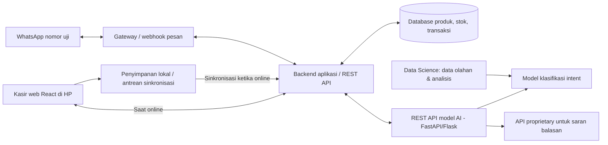

# Sistem Nota Digital & Chatbot Toko Indo Telur

> Capstone Project Asah 2026 · Tim **A26-CS201** · **Status: MVP Pengembangan & Pengujian Lokal**

Sistem Nota Digital & Chatbot Toko Indo Telur adalah aplikasi kasir berbasis web dan layanan AI untuk membantu usaha grosir sembako Toko Indo Telur di Kota Bontang membuat nota lebih cepat, mengelola produk dan pelanggan, mencatat pergerakan stok, serta memberikan respons awal terhadap pesan pelanggan via simulator chatbot.

**Dokumentasi:** [Product Requirements Document (PRD)](./PRD.md) · [Database Schema](./docs/database-schema.md) · [AI Service README](./ai-service/README.md) · [Data Science README](./data-science/README.md)

> **Catatan Status & Batasan Verifikasi:**
> - Proyek ini adalah implementasi MVP untuk demonstrasi dan validasi, **belum dideploy ke URL publik** dan **belum untuk lingkungan produksi**.
> - **Offline:** Saat ini baru memiliki **antrean transaksi berbasis `localStorage`** pada browser saat server terputus, **bukan sistem offline-first penuh** (katalog, pelanggan, dan stok tidak berjalan offline penuh).
> - **Integrasi AI:** Menggunakan **Google Gemini API** (`gemini-3.5-flash-lite`) dengan *factuality guard* dan *fallback* aturan sederhana berbasis kata kunci.
> - **WhatsApp:** **Belum ada bukti integrasi WhatsApp langsung** (tidak ada webhook/konektor WhatsApp live; pengujian dilakukan melalui REST endpoint simulator).
> - **Cetak Nota:** Menggunakan fungsi browser `window.print()` dengan layout struk 58 mm (`@media print`). **Pengujian pada printer fisik Bluetooth Iware ZJ-5809 belum diverifikasi** secara langsung.
> - **Berbagi Nota:** Menggunakan **Web Share API (`navigator.share`)** dengan *fallback* salin teks ke *clipboard* atau unduh file teks `.txt`, **bukan ekspor PDF atau gambar**.

## Status Implementasi Proyek

| Status | Fitur & Komponen | Keterangan Verifikasi |
| --- | --- | --- |
| **Implemented** | API Produk (`/api/products`) | CRUD produk lengkap dengan validasi SKU, nama, harga non-negatif (`GET`, `POST`, `PUT`, `DELETE`). |
| **Implemented** | API Dashboard (`/api/dashboard`) | Endpoint agregat snapshot data toko (`GET /`), CRUD pelanggan (`POST /customers`), CRUD produk dashboard dengan pengelolaan stok (`POST`, `PUT`, `DELETE /products`), pembuatan nota (`POST /receipts`), pembaruan status pemenuhan (`PATCH /receipts/:number/status`), pencatatan pembayaran (`PATCH /receipts/:number/payment`), serta backup & restore (`POST /backup`, `POST /restore`). |
| **Implemented** | Database & Migration PostgreSQL | Migration `001_initial_schema.sql` (5 tabel inti), `002_dashboard.sql` (`customers`, `dashboard_settings`, sequence invoice), dan `003_payment_workflow.sql` (status/metode pembayaran serta `paid_at`). Constraint stok, trigger audit movement, dan idempotency teruji. |
| **Implemented** | Frontend Dashboard Kasir | Antarmuka React 19 + Vite: pembuatan nota 3-langkah (pelanggan, barang, simpan), riwayat nota terfilter, ekspor CSV, manajemen produk dan pelanggan, serta antarmuka backup/restore JSON. |
| **Implemented** | Ekspor Riwayat CSV | Mengunduh file `.csv` riwayat nota langsung dari browser. |
| **Implemented** | AI Intent Classification & Product Matcher | Layanan FastAPI port 8000: klasifikasi 5 kelas intent (`sapaan`, `format_pesanan`, `cek_stok`, `cek_harga`, `lainnya`) dengan model `tfidf_linear_svc` (akurasi 0.9250 pada dataset dummy internal AI), pencocokan produk toleran typo via RapidFuzz, dan saran balasan Gemini. |
| **Partially Implemented** | Mode Offline & Sinkronisasi | Tersedia antrean nota lokal di browser (`indo-telur-receipt-queue-v1` di `localStorage`) saat request gagal; nota dapat disinkronkan manual saat online kembali. Belum mendukung penyimpanan master data offline penuh. |
| **Partially Implemented** | Berbagi Nota Digital | Berbagi teks nota via Web Share API atau clipboard/TXT. Ekspor format PDF atau gambar belum tersedia. |
| **Needs Testing** | Cetak Struk 58 mm | CSS print layout 58 mm tersedia; uji fisik printer Bluetooth Iware ZJ-5809 belum terverifikasi. |
| **Planned** | Integrasi WhatsApp Langsung | Webhook resmi WhatsApp Business API / sandbox belum dihubungkan. Endpoint chatbot saat ini melayani request JSON simulator. |
| **Planned** | Analisis Data Science Transaksi | Analisis pola transaksi riil UMKM, EDA mendalam, dan rekomendasi bisnis masih direncanakan menunggu data transaksi asli UMKM berizin. |
| **Unverified** | Deployment Publik | Belum ada URL hosting publik terverifikasi untuk frontend, backend, maupun AI service. |

## Teknologi yang Digunakan

| Komponen | Teknologi | Deskripsi |
| --- | --- | --- |
| Frontend | React 19, Vite | UI kasir responsif, routing internal (`/produk`, `/nota-baru`, `/katalog-api`), CSS modular. |
| Backend | Node.js, Express 5, `pg` | REST API produk, dashboard, PostgreSQL connection pool, script migrasi & pengujian. |
| Database | PostgreSQL | Relasi 7 tabel, trigger audit stok atomik, sequence invoice `dashboard_invoice_seq`. |
| AI Service | Python 3.11+, FastAPI, scikit-learn | REST API port 8000, model intent classifier, RapidFuzz matcher, Pydantic v2 schemas. |
| Generative AI | Google Gemini API (`google-genai`) | Model default `gemini-3.5-flash-lite` dengan *factuality guard* & *rate limiting*. |
| Data Science | Python 3 | Dataset intent dummy 250 baris, evaluasi baseline TF-IDF + Naive Bayes tanpa library luar. |

## Struktur Folder Repository

```text
.
├── ai-service/             # Layanan AI FastAPI (klasifikasi intent & chatbot)
│   ├── artifacts/          # Model terlatih (intent_model.joblib) & laporan evaluasi
│   ├── data/               # Dataset intent dummy (202 raw) & katalog produk sampel
│   ├── src/                # Kode sumber API (main.py, orchestrator, matcher, schemas)
│   ├── tests/              # Test suite pytest komprehensif
│   ├── Dockerfile          # Kontainerisasi layanan AI
│   └── requirements.txt    # Dependensi Python AI service
├── backend/                # API Express & Database PostgreSQL
│   ├── scripts/            # Script run-migrations, verify-database, test scripts
│   ├── src/
│   │   ├── config/         # Konfigurasi pool PostgreSQL
│   │   ├── controllers/    # Controller produk
│   │   ├── database/       # File migrasi SQL (001_initial_schema hingga 003_payment_workflow)
│   │   ├── routes/         # Router Express (products, dashboard)
│   │   └── server.js       # Entry point Express backend (port 3000)
│   └── package.json        # Dependensi dan script backend
├── data-science/           # Eksperimen data dummy & baseline evaluasi
│   ├── data/               # dataset_intent_dummy.csv (250 baris) & products_dummy.csv
│   ├── evaluasi_intent.py  # Script validasi dataset & baseline TF-IDF + Naive Bayes
│   └── README.md           # Dokumentasi data science
├── docs/                   # Dokumentasi teknis pendukung
│   └── database-schema.md  # Dokumentasi skema database, ERD, dan aturan audit stok
├── frontend/               # Aplikasi web React + Vite
│   ├── src/                # Komponen kasir (ReceiptPage.jsx, App.jsx, dashboardApi.js)
│   ├── package.json        # Dependensi React 19 & Oxlint
│   └── vite.config.js      # Konfigurasi proxy Vite ke backend (/api -> port 3000)
├── PRD.md                  # Product Requirements Document & status requirement
└── README.md               # Dokumentasi utama proyek
```

Di terminal lain, dari folder `frontend`:

```powershell
npm.cmd ci
npm.cmd run dev
```

Buka [Produk dan stok](http://localhost:5173/produk) atau [Nota baru](http://localhost:5173/nota-baru). Database baru dimulai kosong. Tambahkan produk beserta stok awal, lalu tambahkan pelanggan dari Nota baru.

- Jika server terputus setelah halaman terbuka, nota dapat masuk antrean browser. Gunakan **Sinkronkan sekarang** untuk mengirim ulang. Server memeriksa stok dan harga saat menerima nota, serta mencegah nota ganda berdasarkan ID pengiriman.
- Backup JSON v2 mencakup produk, stok saat ini, pelanggan, dan nota yang sudah diterima server, termasuk status, metode, dan waktu pembayaran bila tersedia. Pemulihan menggunakan database kosong yang sudah dimigrasi; backup historis tanpa `paidAt` tetap didukung. Riwayat pergerakan stok dari database sumber tetap berada di database sumber.
- Untuk pengujian API dashboard, jalankan `npm.cmd run test:dashboard` dari `backend`. Uji memakai skema PostgreSQL terpisah dan menghapus skema uji setelah selesai.

## Latar belakang

Toko Indo Telur menjual sembako secara grosir kepada pemilik toko dan pedagang eceran. Pesanan diterima melalui WhatsApp maupun langsung di gudang. Selama ini pemilik menghitung pesanan dan menulis nota secara manual; ketika chat ramai, respons dapat terlambat dan nota terkadang baru siap menjelang pengantaran.

Proyek ini berfokus pada digitalisasi nota sekaligus mempertahankan rencana tim untuk manajemen stok, sinkronisasi data, dan chatbot WhatsApp. Perluasan tersebut tetap memerlukan konfirmasi kesesuaian dengan UMKM dan Tim Asah.

## Tujuan

- Memudahkan pemilik membuat nota penjualan yang akurat, tersimpan, dan siap sebelum pengantaran.
- Menyediakan pengelolaan produk, harga, stok, dan riwayat transaksi.
- Memungkinkan kasir bekerja secara lokal saat offline, kemudian menyinkronkan transaksi ketika online.
- Mendukung cetak nota di printer Bluetooth milik toko dan berbagi nota digital.
- Membantu membalas sapaan/format pemesanan serta pertanyaan harga dan ketersediaan produk melalui WhatsApp **nomor uji**.
- Mengintegrasikan pekerjaan Full-Stack, Data Science, dan Gen AI sesuai Main Quest Asah 2026.

## Fitur yang direncanakan

| Area | Fitur | Keterangan |
| --- | --- | --- |
| Kasir | Pembuatan nota digital | Pilih produk & jumlah, hitung total otomatis, simpan nota. |
| Produk | Kelola daftar produk dan harga | Tambah, ubah, hapus; perubahan harga tidak mengubah nota lama. |
| Inventori | Pengaturan stok otomatis | Stok diperbarui saat transaksi tersimpan; cegah jumlah melebihi stok. |
| Transaksi | Riwayat nota | Lihat kembali tanggal, item, dan total transaksi. |
| Offline | Kasir offline & online | Nota, produk, dan stok lokal tetap berjalan tanpa internet setelah aplikasi siap digunakan. |
| Cetak | Nota thermal Bluetooth 58 mm | Uji pada printer toko **Iware ZJ-5809**; tersedia opsi cetak pendamping bila dibutuhkan. |
| Pemulihan | Backup & restore file | Ekspor data dan pulihkan ke perangkat lain; file tidak valid ditolak. |
| Sinkronisasi | Stok & penjualan ke server | Kirim data ketika online, hindari pengiriman nota ganda. |
| Backend | Database stok online | Sumber data produk/harga/stok untuk aplikasi dan chatbot. |
| WhatsApp | Balasan otomatis dasar | Sapaan dan petunjuk format pemesanan melalui nomor uji. |
| WhatsApp + AI | Tanya harga dan stok | Bot membaca data server; tidak mengubah stok atau memproses pembayaran. |
| Berbagi | Nota digital gambar/PDF | Bagikan ke pengantar atau pelanggan sebagai alternatif cetak. |
| Ekspor | Riwayat transaksi CSV | Unduh riwayat untuk dibuka di aplikasi spreadsheet. |

**Pekerjaan lintas learning path:** antarmuka responsif dengan status proses/sukses/gagal, URL web publik, pengolahan dan analisis dataset, penyiapan data untuk AI, klasifikasi maksud pesan, fitur saran balasan generatif, evaluasi minimal dua model/konfigurasi, serta REST API AI online.

## Alur utama

1. Pemilik membuka aplikasi kasir melalui browser HP Android.
2. Pemilik memilih produk dan jumlah; sistem menampilkan total dan memeriksa stok.
3. Transaksi disimpan, stok lokal diperbarui, dan nota masuk riwayat.
4. Nota dicetak di printer toko atau dibagikan dalam format gambar/PDF.
5. Jika sedang offline, transaksi tetap disimpan di perangkat dan dijadwalkan untuk sinkronisasi ketika internet tersedia.
6. Pelanggan menghubungi **nomor WhatsApp uji**; chatbot menangani sapaan, format pesanan, atau pertanyaan stok/harga menggunakan data server.

> **Perhatian:** stok yang dibacakan chatbot saat transaksi offline belum tersinkron dapat berbeda dari kondisi toko. Bot harus menyatakan informasi sebagai perkiraan bila data belum mutakhir.

## Rencana teknologi

Pilihan di bawah mengikuti Project Plan; komponen yang belum diputuskan **tidak dianggap sudah terpasang**.

| Lapisan | Teknologi / pendekatan | Status keputusan |
| --- | --- | --- |
| Frontend web | React | Pilihan tim |
| Data Science | Python, Pandas | Pilihan tim |
| Model AI | Model klasifikasi maksud pesan yang dilatih dari data yang diizinkan/dummy | Dalam perencanaan |
| Gen AI | API model proprietary untuk menyusun saran balasan | Penyedia belum dipilih |
| REST API AI | **FastAPI atau Flask** | Pilih salah satu saat implementasi |
| Backend aplikasi | Node.js + Express | API produk, pelanggan, nota, backup, dan pengiriman ulang nota tersedia di dashboard lokal |
| Database online | PostgreSQL + `pg` untuk produk, stok, transaksi, dan sinkronisasi | Skema initial dan migration sudah diterapkan |
| Penyimpanan offline | Penyimpanan lokal browser dan berkas cadangan | Implementasi teknis belum diputuskan |
| Deployment | Hosting publik untuk web dan API | Penyedia/URL belum tersedia |
| Integrasi chat | WhatsApp nomor uji/sandbox | Bergantung izin dan akses layanan |
| Printer | Iware ZJ-5809, kertas 58 mm | Kompatibilitas web–Bluetooth perlu diuji |

### Rancangan arsitektur



Diagram ini menunjukkan **rancangan arsitektur target**. Web kasir lokal memakai Express dan PostgreSQL. Nota yang dibuat saat koneksi ke backend terputus dapat dikirim ulang dari antrean browser ketika server kembali tersedia. Integrasi WhatsApp dan sinkronisasi lintas perangkat berada di luar dashboard lokal ini.

## Dokumentasi pengembangan

Dokumen saat ini:

- [`README.md`](./README.md) — pengantar proyek, fitur, dan rencana implementasi.
- [`PRD.md`](./PRD.md) — requirement, alur, aturan bisnis, acceptance criteria, arsitektur, dan pengujian.

## Panduan Menjalankan Layanan Lokal

### 1. Backend & Database Migration (Node.js & PostgreSQL)

Pastikan service PostgreSQL berjalan lokal. Buat file `backend/.env` berdasarkan konfigurasi database Anda (misalnya database `toko_indo_telur`):

```env
PGHOST=localhost
PGPORT=5432
PGDATABASE=toko_indo_telur
PGUSER=postgres
PGPASSWORD=rahasia_anda
PORT=3000
FRONTEND_URL=http://localhost:5173
```

Jalankan perintah berikut dari folder `backend/`:

```powershell
cd backend
npm.cmd install
npm.cmd run migrate       # Menjalankan migrasi 001 hingga 003 secara idempoten
npm.cmd run db:verify     # Memverifikasi integritas tabel & constraint (rollback aman)
npm.cmd run dev           # Menjalankan backend di http://localhost:3000
```

### 2. Frontend Dashboard (React + Vite)

Jalankan perintah berikut di terminal terpisah dari folder `frontend/`:

```powershell
cd frontend
npm.cmd install
npm.cmd run dev
```

Buka URL aplikasi di browser:
- **Nota Baru:** [http://localhost:5173/nota-baru](http://localhost:5173/nota-baru) (Alur kasir 3 langkah: pilih pelanggan, isi barang, simpan draft/siap).
- **Produk & Stok:** [http://localhost:5173/produk](http://localhost:5173/produk) (Katalog, status stok, form tambah/edit).
- **Katalog API Alternatif:** [http://localhost:5173/katalog-api](http://localhost:5173/katalog-api) (Halaman antarmuka Product API langsung).

> **Alur Antrean Offline:** Jika backend tidak dapat dijangkau saat menyimpan nota, transaksi otomatis disimpan ke antrean browser (`localStorage`). Buka menu **Sinkron** dan klik **Sinkronkan sekarang** saat backend kembali aktif.

### 3. AI Service (FastAPI)

Jalankan di terminal terpisah dari folder `ai-service/`:

```powershell
cd ai-service
python -m venv .venv
.\.venv\Scripts\Activate.ps1
pip install -r requirements.txt
cp .env.example .env
uvicorn src.main:app --host 0.0.0.0 --port 8000 --reload
```

Dokumentasi Swagger OpenAPI interaktif tersedia di [http://localhost:8000/docs](http://localhost:8000/docs).
Untuk mengaktifkan balasan Gemini, isi variabel `GEMINI_API_KEY` di `ai-service/.env`. Jika kosong, layanan secara otomatis menggunakan *fallback* aturan sederhana yang deterministik dan aman.

---

## Verifikasi & Pengujian yang Tersedia

Pengujian yang sudah dapat dijalankan dan diverifikasi di repository ini:

1. **Database Schema & Constraints (`backend/`):**
   ```powershell
   cd backend
   npm.cmd run db:verify
   ```
   *Memverifikasi 5 tabel aplikasi awal, 5 foreign key, validasi harga non-negatif, stok non-negatif, pencegahan stok minus pada penjualan, serta trigger audit movement (data uji selalu di-rollback).*

2. **Integration Test Product API (`backend/`):**
   ```powershell
   cd backend
   npm.cmd run test:products
   ```
   *Menguji endpoint CRUD produk, validasi SKU duplikat, larangan perubahan stok langsung via Product API, dan konflik relasi pada database.*

3. **Integration Test Dashboard API (`backend/`):**
   ```powershell
   cd backend
   npm.cmd run test:dashboard
   ```
   *Menguji skema terisolasi untuk pembuatan pelanggan, produk dashboard, stok atomik, idempotensi nota draft/ready, status delivered, sinkronisasi, dan backup/restore.*

4. **Linting & Build Frontend (`frontend/`):**
   ```powershell
   cd frontend
   npm.cmd run lint      # Oxlint
   npm.cmd run build     # Vite production build
   ```

5. **AI Service Test Suite (`ai-service/`):**
   ```powershell
   cd ai-service
   pytest -v
   ```
   *Menguji seluruh endpoint (`/ai/health`, `/ai/predict-intent`, `/ai/suggest-reply`, `/ai/chatbot/respond`), normalisasi teks, factuality guard Gemini, simulasi fallback, dan product matcher.*

6. **Evaluasi Baseline Intent Data Science (`data-science/`):**
   ```powershell
   python data-science/evaluasi_intent.py
   ```
   *Memvalidasi 250 data dummy (0 baris kosong, 0 duplikat, 0 label tak dikenal) dan mengevaluasi baseline TF-IDF + Naive Bayes dengan akurasi dan Macro-F1 sekitar 0.86.*

---

## Daftar Endpoint API Aktual

### Backend Express (Port 3000)

| Method | Endpoint | Fungsi |
| --- | --- | --- |
| `GET` | `/api/health` | Cek status server Express backend |
| `GET` | `/api/db-check` | Cek koneksi live ke PostgreSQL dan waktu server |
| `GET` | `/api/products` | Mengambil seluruh daftar produk terurut nama |
| `GET` | `/api/products/:id` | Detail produk berdasarkan ID |
| `POST` | `/api/products` | Tambah produk baru (stok awal selalu 0) |
| `PUT` | `/api/products/:id` | Ubah data produk (stok tidak dapat diubah di sini) |
| `DELETE` | `/api/products/:id` | Hapus produk (ditolak jika memiliki relasi transaksi/stok) |
| `GET` | `/api/dashboard/` | Mengambil snapshot lengkap produk, pelanggan, riwayat nota, & pengaturan |
| `POST` | `/api/dashboard/customers` | Tambah data pelanggan baru |
| `POST` | `/api/dashboard/products` | Tambah produk dashboard beserta stok awal |
| `PUT` | `/api/dashboard/products/:id` | Ubah produk dashboard & sesuaikan stok via stock_movements |
| `DELETE` | `/api/dashboard/products/:id` | Nonaktifkan produk dashboard (soft delete `is_active=false`) |
| `POST` | `/api/dashboard/receipts` | Buat nota baru (status `draft` / `ready`; potong stok jika `ready`) |
| `PATCH` | `/api/dashboard/receipts/:number/status` | Ubah status nota (`ready`, `delivered`) |
| `PATCH` | `/api/dashboard/receipts/:number/payment` | Catat pembayaran `cash` atau `transfer` untuk nota `delivered` yang `unpaid`; retry dengan metode sama mengembalikan pembayaran yang sama tanpa mengubah `paid_at`, sedangkan metode berbeda ditolak. |
| `POST` | `/api/dashboard/backup` | Unduh cadangan JSON produk, pelanggan, nota, dan stok terkini |
| `POST` | `/api/dashboard/restore` | Pulihkan cadangan JSON ke database kosong |

### AI Service FastAPI (Port 8000)

| Method | Endpoint | Fungsi |
| --- | --- | --- |
| `GET` | `/ai/health` | Cek kesehatan layanan AI, status model aktif, dan konfigurasi API key |
| `POST` | `/ai/predict-intent` | Klasifikasi 5 intent pesan dengan output skor probabilitas |
| `POST` | `/ai/suggest-reply` | Saran balasan generatif berbasis Gemini atau fallback aturan deterministik |
| `POST` | `/ai/chatbot/respond` | Simulator respons pesan end-to-end (intent + catalog lookup + reply) |

---

## Status Dataset & Model AI

1. **Dataset AI Service (`ai-service/data/intent_dataset_dummy.csv`):**
   - Berisi **202 baris mentah** yang menghasilkan **200 baris unik** setelah normalisasi dan deduplikasi (40 baris seimbang per kelas intent).
   - Menghasilkan model terbaik **`tfidf_linear_svc`** dengan **Accuracy 0.9250** dan **Macro-F1 0.9229** pada test set terpisah (40 sampel).
2. **Dataset Data Science (`data-science/data/dataset_intent_dummy.csv`):**
   - Berisi **250 pesan dummy** (50 baris per kelas intent) yang divalidasi oleh `evaluasi_intent.py` menghasilkan baseline Accuracy dan Macro-F1 sebesar **0.86**.
   - **Catatan Handoff:** Nilai 0.925 dan 0.86 **tidak boleh dibandingkan langsung** karena ukuran dataset, pemisahan data, dan metodologi eksperimen berbeda. Model aktif pada AI Service saat ini **belum dilatih ulang (retrain)** dengan dataset Data Science 250 baris tersebut.

---

## Roadmap Pengembangan Berikutnya

1. **Pengujian Fisik Printer Thermal:** Verifikasi koneksi Bluetooth dan hasil cetakan nota 58 mm pada printer fisik Iware ZJ-5809.
2. **Integrasi Webhook WhatsApp:** Membangun gateway / webhook resmi WhatsApp Business API atau sandbox untuk menghubungkan chat masuk ke endpoint `/ai/chatbot/respond`.
3. **Penyempurnaan Offline Mode:** Mengembangkan sinkronisasi dua arah offline-first penuh menggunakan IndexedDB dan Service Worker agar katalog produk dan pelanggan tetap dapat dibuka saat offline.
4. **Analisis Data Transaksi UMKM:** Melakukan analisis eksploratori (EDA) dan pemodelan data transaksi riil dari Toko Indo Telur setelah persetujuan data diperoleh.
5. **Retraining Model AI:** Melakukan proses handoff formal dataset dari tim Data Science ke tim AI Service untuk retraining model klasifikasi intent.
6. **Keamanan & Deployment Publik:** Mengonfigurasi variabel autentikasi API (`AI_SERVICE_API_KEY`), CORS ketat, serta melakukan deployment publik frontend, backend, dan AI service dengan HTTPS.

## Tim

| Anggota | Learning path | Fokus sesuai Project Plan |
| --- | --- | --- |
| M. Naufal Adi Brata Putra Suharizman Poerwo | AI Full-Stack Developer | Kasir, nota, backend, integrasi dan koordinasi |
| Ikhwan Hariyanto | AI Full-Stack Developer | UI/UX, produk, pencetakan dan panduan |
| Ridwan Nur Rahman | AI Full-Stack Developer | Offline, stok, sinkronisasi, backup dan API |
| Muhammad Ridwanansyah Rahman | Data Science Specialist | Analisis bisnis, validasi, rekomendasi dan dokumentasi data |
| Jovan Bagas Pangestu | Data Science Specialist | Data wrangling, kualitas data, dataset/model testing |
| Winsen | Next Gen AI Engineer | Model klasifikasi, evaluasi, generative AI, REST API dan chatbot |

## Batasan dan catatan penting

- **Belum untuk produksi.** Sistem adalah rencana prototype/MVP capstone yang harus diuji dan dinilai UMKM.
- Fitur stok otomatis, sinkronisasi, chatbot cek stok/harga, dan ekspor CSV merupakan **perluasan dari use case awal**. Fitur-fitur ini tetap menjadi ruang lingkup rencana tim, tetapi persetujuan formal UMKM/Tim Asah masih perlu dikonfirmasi.
- WhatsApp diuji pada **nomor uji**, bukan nomor pelanggan asli.
- Kasir offline tidak berarti WhatsApp, AI generatif, atau sinkronisasi bisa berjalan tanpa internet.
- Integrasi printer Bluetooth pada browser Android perlu uji kompatibilitas; jika gagal, rencana cadangannya adalah aplikasi cetak pendamping atau nota gambar/PDF.
- Tidak ada klaim pengurangan waktu kerja atau peningkatan penjualan sebelum hasil uji nyata tersedia.
- **Lisensi publik belum ditetapkan.** Jangan menganggap repository otomatis berlisensi open source sebelum pemilik repository memilih lisensinya.

---

Dibuat sebagai dokumentasi rencana **Capstone Asah 2026 – A26-CS201**, berdasarkan Project Plan revisi dan hasil wawancara/use case UMKM.
