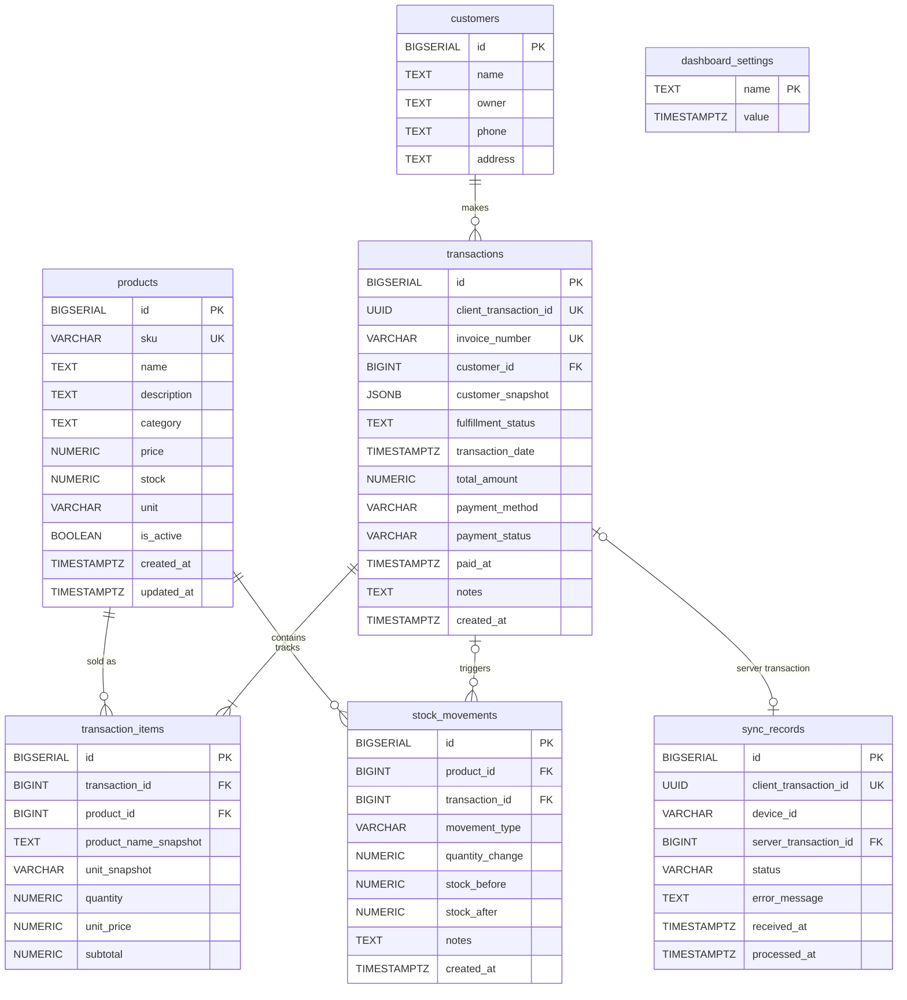

# Database Schema — Toko Indo Telur

Dokumentasi skema database PostgreSQL untuk sistem kasir dan inventori Toko Indo Telur, mencakup migration `001_initial_schema.sql`, `002_dashboard.sql`, dan `003_payment_workflow.sql`.

## ERD (Entity Relationship Diagram)



## Daftar Tabel dan Kolom

### 1. `customers` (Ditambahkan pada `002_dashboard.sql`)
Menyimpan data master pelanggan grosir dan warung rekanan Toko Indo Telur.
- `id BIGSERIAL PRIMARY KEY`: ID unik pelanggan.
- `name TEXT NOT NULL`: Nama toko / pelanggan (CHECK: tidak boleh kosong/spasi saja).
- `owner TEXT NOT NULL DEFAULT ''`: Nama pemilik toko.
- `phone TEXT NOT NULL DEFAULT ''`: Nomor kontak telepon / WhatsApp.
- `address TEXT NOT NULL DEFAULT ''`: Alamat atau area pengantaran toko.

### 2. `products`
Katalog produk master dan stok toko terkini untuk kasir dan AI Service.
- `id BIGSERIAL PRIMARY KEY`: ID produk.
- `sku VARCHAR(64) UNIQUE`: Kode SKU produk (opsional, unik jika diisi).
- `name TEXT NOT NULL`: Nama produk sembako (CHECK: tidak boleh kosong/spasi saja).
- `description TEXT`: Keterangan detail produk.
- `category TEXT NOT NULL DEFAULT 'Lainnya'`: Kategori sembako (mis. Telur, Beras, Minyak, Gula, Tepung, Mi instan, Kopi, Lainnya; ditambahkan pada `002_dashboard.sql`).
- `price NUMERIC(14, 2) NOT NULL`: Harga jual saat ini (CHECK: $\ge 0$). Nota historis tidak menggunakan harga ini, melainkan harga snapshot di `transaction_items`.
- `stock NUMERIC(14, 3) NOT NULL DEFAULT 0`: Jumlah stok fisik saat ini (CHECK: $\ge 0$). **Hanya boleh diubah melalui trigger `stock_movements`**.
- `unit VARCHAR(32) NOT NULL DEFAULT 'pcs'`: Satuan produk (rak, kg, liter, karung, dus, dll).
- `is_active BOOLEAN NOT NULL DEFAULT TRUE`: Penanda soft-delete; produk yang pernah ditransaksikan tidak boleh dihapus keras (hard delete).
- `created_at TIMESTAMPTZ NOT NULL DEFAULT NOW()`: Waktu pembuatan produk.
- `updated_at TIMESTAMPTZ NOT NULL DEFAULT NOW()`: Waktu pembaruan produk (otomatis via trigger).

### 3. `transactions`
Mencatat setiap transaksi nota penjualan digital.
- `id BIGSERIAL PRIMARY KEY`: ID internal database transaksi.
- `client_transaction_id UUID NOT NULL UNIQUE`: UUID unik yang dibuat oleh perangkat browser untuk mencegah duplikasi nota saat retry sinkronisasi.
- `invoice_number VARCHAR(80) NOT NULL UNIQUE`: Nomor nota resmi (format dashboard: `NT-` + 12 digit sequence dari `dashboard_invoice_seq`).
- `customer_id BIGINT REFERENCES customers(id)`: Relasi opsional ke tabel pelanggan (ditambahkan pada `002_dashboard.sql`).
- `customer_snapshot JSONB`: Snapshot data pelanggan (nama, pemilik, kontak, alamat) saat nota diterbitkan agar historis tidak berubah jika master pelanggan disunting.
- `fulfillment_status TEXT NOT NULL DEFAULT 'delivered'`: Status pemenuhan pesanan dengan batasan CHECK: `('draft', 'ready', 'delivered')`. Stok terpotong saat berstatus `ready` atau langsung `delivered`.
- `transaction_date TIMESTAMPTZ NOT NULL DEFAULT NOW()`: Tanggal dan waktu transaksi.
- `total_amount NUMERIC(14, 2) NOT NULL DEFAULT 0`: Total nominal transaksi (otomatis dihitung ulang via trigger dari subtotal `transaction_items`).
- `payment_method VARCHAR(16)`: Metode pembayaran. Bernilai `NULL` untuk nota `unpaid`; bila terisi, nilainya hanya `'cash'` atau `'transfer'`.
- `payment_status VARCHAR(16) NOT NULL DEFAULT 'unpaid'`: Status pembayaran (CHECK: `'unpaid'`, `'paid'`, `'partial'`).
- `paid_at TIMESTAMPTZ`: Waktu pembayaran tercatat. `NULL` untuk nota `unpaid`; nilai `NULL` juga tetap sah pada transaksi `paid`/`partial` historis yang memang tidak memiliki timestamp.
- `notes TEXT`: Catatan tambahan transaksi.
- `created_at TIMESTAMPTZ NOT NULL DEFAULT NOW()`: Timestamp rekaman masuk ke database.

### 4. `transaction_items`
Rincian item barang pada setiap nota transaksi.
- `id BIGSERIAL PRIMARY KEY`: ID unik baris item.
- `transaction_id BIGINT NOT NULL REFERENCES transactions(id) ON DELETE RESTRICT`: Foreign key ke nota.
- `product_id BIGINT NOT NULL REFERENCES products(id) ON DELETE RESTRICT`: Foreign key ke produk master.
- `product_name_snapshot TEXT NOT NULL`: Nama barang saat nota dicetak.
- `unit_snapshot VARCHAR(32) NOT NULL`: Satuan barang saat nota dicetak.
- `quantity NUMERIC(14, 3) NOT NULL`: Jumlah barang yang dibeli (CHECK: $> 0$).
- `unit_price NUMERIC(14, 2) NOT NULL`: Harga satuan saat nota dicetak (CHECK: $\ge 0$).
- `subtotal NUMERIC(14, 2) GENERATED ALWAYS AS (ROUND(quantity * unit_price, 2)) STORED`: Nilai subtotal yang dihitung dan disimpan otomatis oleh PostgreSQL.

### 5. `stock_movements`
Catatan audit trail pergerakan stok barang yang bersifat *immutable* (tidak dapat diubah atau dihapus).
- `id BIGSERIAL PRIMARY KEY`: ID pergerakan stok.
- `product_id BIGINT NOT NULL REFERENCES products(id) ON DELETE RESTRICT`: ID produk terkait.
- `transaction_id BIGINT REFERENCES transactions(id) ON DELETE RESTRICT`: ID transaksi terkait (wajib jika movement adalah `sale`).
- `movement_type VARCHAR(16) NOT NULL`: Jenis pergerakan (CHECK: `'sale'`, `'restock'`, `'adjustment'`, `'return'`).
- `quantity_change NUMERIC(14, 3) NOT NULL`: Nilai perubahan stok (negatif untuk `sale`, positif untuk `restock`/`return`, CHECK: $\ne 0$).
- `stock_before NUMERIC(14, 3) NOT NULL`: Nilai stok sebelum perubahan (CHECK: $\ge 0$).
- `stock_after NUMERIC(14, 3) NOT NULL`: Nilai stok setelah perubahan (CHECK: $\ge 0$, konsisten `stock_before + quantity_change`).
- `notes TEXT`: Alasan atau keterangan pergerakan stok.
- `created_at TIMESTAMPTZ NOT NULL DEFAULT NOW()`: Timestamp pencatatan audit.

### 6. `sync_records`
Pelacak daur hidup pengiriman transaksi offline dari browser ke server untuk menjamin idempotensi.
- `id BIGSERIAL PRIMARY KEY`: ID record sinkronisasi.
- `client_transaction_id UUID NOT NULL UNIQUE`: UUID transaksi dari perangkat kasir.
- `device_id VARCHAR(128) NOT NULL`: Pengenal perangkat pengirim (misal: `'web'`, `'backup'`).
- `server_transaction_id BIGINT UNIQUE REFERENCES transactions(id) ON DELETE RESTRICT`: ID transaksi yang berhasil dibuat di server.
- `status VARCHAR(16) NOT NULL DEFAULT 'received'`: Status pemrosesan (CHECK: `'received'`, `'processed'`, `'failed'`).
- `error_message TEXT`: Keterangan kegagalan jika status bernilai `'failed'`.
- `received_at TIMESTAMPTZ NOT NULL DEFAULT NOW()`: Waktu request diterima server.
- `processed_at TIMESTAMPTZ`: Waktu selesai diproses atau gagal.

### 7. `dashboard_settings` (Ditambahkan pada `002_dashboard.sql`)
Menyimpan pasangan metadata key-value bertipe timestamp untuk operasional dashboard.
- `name TEXT PRIMARY KEY`: Nama konfigurasi (misalnya `'lastBackup'`, `'lastSync'`).
- `value TIMESTAMPTZ NOT NULL`: Nilai timestamp terakhir operasi dilakukan.

---

## Aturan Mutasi Stok & Penegakan Integritas Data

1. **Pembuatan Produk Baru:**
   - Produk baru wajib diawali dengan nilai `stock = 0`. Penegakan dilakukan oleh trigger `trg_products_require_zero_initial_stock`.
2. **Restock Awal & Penyesuaian Stok:**
   - Menambah stok awal atau penyesuaian wajib memasukkan baris baru ke tabel `stock_movements` (dengan tipe `'restock'` atau `'adjustment'`).
   - Trigger `trg_stock_movements_apply_stock` secara otomatis mengunci baris produk (`FOR UPDATE`), memvalidasi bahwa stok tidak menjadi negatif, menghitung `stock_before` dan `stock_after`, serta memperbarui kolom `products.stock` dalam satu transaksi atomik.
3. **Pencegahan Mutasi Langsung:**
   - Kolom `products.stock` dilindungi oleh trigger `trg_products_prevent_direct_stock_update` sehingga perintah `UPDATE products SET stock = ...` langsung ditolak jika tidak dipanggil dari dalam eksekusi trigger `stock_movements`.
4. **Immutability Catatan Audit:**
   - Baris pada `stock_movements` dilindungi trigger `trg_stock_movements_immutable` yang menolak setiap operasi `UPDATE` maupun `DELETE`.
5. **Perhitungan Total Nota Otomatis:**
   - Kolom `transactions.total_amount` selalu diperbarui otomatis oleh trigger `trg_transaction_items_refresh_total` setiap ada penambahan, perubahan, atau penghapusan item di `transaction_items`.
6. **Relasi Penghapusan (`ON DELETE RESTRICT`):**
   - Seluruh foreign key menggunakan opsi `ON DELETE RESTRICT` sehingga produk yang sudah memiliki riwayat penjualan atau pergerakan stok tidak dapat dihapus secara keras dari database. Gunakan flag soft-delete `is_active = false`.
7. **Konsistensi Pembayaran:** Migration `003_payment_workflow.sql` menormalkan receipt `unpaid` lama menjadi tanpa metode pembayaran, lalu menegakkan bahwa receipt `unpaid` tidak boleh memiliki `payment_method` maupun `paid_at`. Receipt `paid` dan `partial` wajib mempunyai metode `cash` atau `transfer`; timestamp historis tidak diisi secara sintetis.

## Payment API

`PATCH /api/dashboard/receipts/:number/payment` menerima `{ "paymentMethod": "cash" | "transfer" }`. Endpoint mengunci nota dan, untuk nota `delivered` yang masih `unpaid`, menyimpan `payment_status = 'paid'`, metode yang dipilih, serta `paid_at = NOW()` secara atomik. Jika nota sudah `paid`, request dengan metode sama bersifat idempoten: endpoint mengembalikan metode dan `paid_at` tersimpan tanpa `UPDATE`. Metode berbeda, receipt `partial`, atau receipt yang belum `delivered` ditolak dengan `409`.

Dashboard snapshot dan backup JSON v2 menyertakan `paymentMethod`, `paymentStatus`, dan `paidAt`. Restore tetap menerima backup v2 sebelum kolom `paidAt` tersedia dan mempertahankan nilainya sebagai `NULL`; backup lama dengan receipt `unpaid` dan metode default lama dinormalisasi menjadi tanpa metode.

---

## Idempotensi Transaksi & Alur Sinkronisasi Offline

Untuk mencegah pencatatan transaksi ganda akibat gangguan jaringan atau retry pengiriman:
1. Browser kasir membuat satu UUID stabil (`crypto.randomUUID()`) sebelum menyimpan nota ke penyimpanan lokal (`localStorage`).
2. Saat dikirim ke server (`POST /api/dashboard/receipts`), backend mengunci transaksi secara atomik menggunakan advisory lock PostgreSQL:
   ```sql
   SELECT pg_advisory_xact_lock(hashtextextended(clientId, 0));
   ```
3. Backend memeriksa apakah `client_transaction_id` sudah ada pada tabel `transactions`:
   - Jika sudah ada, backend langsung mengembalikan nomor nota yang sudah tercatat tanpa membuat transaksi baru (idempoten).
   - Jika belum ada, backend memvalidasi pelanggan, mengunci stok produk terkait (`FOR UPDATE`), memeriksa kecukupan stok, menyimpan baris `transactions`, menyimpan rincian `transaction_items`, mencatat pengurangan stok pada `stock_movements` jika status `ready`, dan mencatat `sync_records` dengan status `'processed'`.
4. Seluruh rangkaian operasi tersebut dijalankan di dalam satu database transaction PostgreSQL (`BEGIN ... COMMIT`). Jika ada kesalahan (misalnya stok tidak mencukupi atau harga berubah), transaksi otomatis di-rollback tanpa menyisakan data parsial.

---

## Verifikasi Migration & Temuan Database

### Cara Menjalankan Migrasi & Verifikasi
Dari folder `backend/`:
```powershell
npm.cmd run migrate    # Menjalankan script run-migrations.js dengan advisory lock
npm.cmd run db:verify  # Memverifikasi 5 tabel awal, foreign key, dan constraint
```

### Temuan Implementasi Database untuk Pekerjaan Lanjutan
Berdasarkan pemeriksaan langsung antara migrasi dan skrip verifikasi:
1. Skrip `backend/scripts/verify-database.js` saat ini baru memverifikasi 5 tabel dari migrasi `001_initial_schema.sql` (`products`, `transactions`, `transaction_items`, `stock_movements`, `sync_records`). Tabel `customers` dan `dashboard_settings` dari `002_dashboard.sql` belum dimasukkan ke dalam daftar asersi `expectedTables` skrip tersebut (telah dicatat sebagai rekomendasi pekerjaan lanjutan).
2. Perubahan skema database di masa mendatang wajib dibuat melalui file migrasi baru (misalnya `003_xxx.sql`), tidak diperkenankan mengubah file migrasi `001` atau `002` karena mekanisme checksum SHA-256 pada tabel `schema_migrations` akan menolak file yang berubah.
