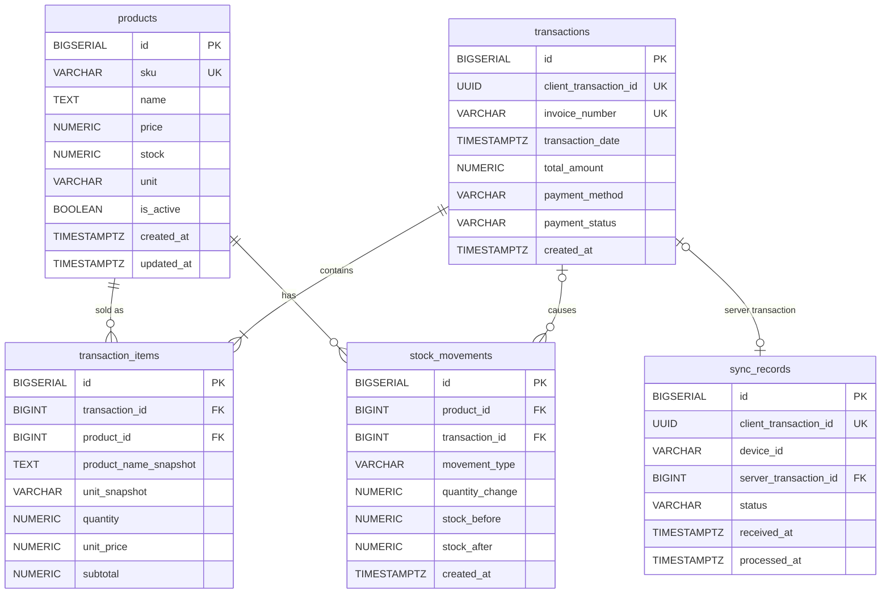

# Database schema — Toko Indo Telur

## ERD



## Tables and columns

### `products`

Master product and current server-side inventory for the cashier and chatbot. `price NUMERIC(14,2)` is the current price only; old receipts use snapshots in `transaction_items`. `stock NUMERIC(14,3)` permits both unit and weight-based merchandise, but it is only changed by `stock_movements`. `sku` is optional and unique when present. `is_active` is the soft-delete flag; products with history are deactivated, not deleted.

### `transactions`

One digital receipt. `client_transaction_id UUID` is the stable ID produced by the device and has a unique constraint. `invoice_number` is separately unique for a human-readable receipt number. `total_amount NUMERIC(14,2)` is recalculated from the item subtotals by a trigger. Values for `payment_method` are `cash` and `transfer`; `payment_status` is `unpaid`, `paid`, or `partial`. `transaction_date` and `created_at` use `TIMESTAMPTZ`.

### `transaction_items`

Receipt lines. `product_name_snapshot`, `unit_snapshot`, and `unit_price` preserve the displayed receipt even after a product is renamed, repriced, or deactivated. `quantity` must be greater than zero. `subtotal` is a stored generated value of `quantity × unit_price`, rounded to two decimal places.

### `stock_movements`

Immutable inventory audit trail. Each record belongs to a product; a sale also refers to its receipt. Allowed values are `sale`, `restock`, `adjustment`, and `return`. Sales must be negative and tied to a transaction; restocks and returns must be positive. A trigger locks the product row, calculates `stock_before` and `stock_after`, rejects a negative result, and updates `products.stock` in the same database transaction.

### `sync_records`

Tracks the lifecycle of an offline submission. A record is identified by the device-provided `client_transaction_id`, which is unique. `server_transaction_id` is set only after the server transaction exists and is verified to point to the transaction with the same client ID. Status lifecycle is:

| Status | `server_transaction_id` | `processed_at` | `error_message` |
| --- | --- | --- | --- |
| `received` | null | null | null |
| `processed` | required | required | null |
| `failed` | null | required | required |

## Constraints and indexes

- Primary keys use `BIGSERIAL`; all relations use foreign keys with `ON DELETE RESTRICT`, preserving receipt and stock audit history.
- Check constraints reject blank identifiers/names/units, negative monetary values and stock, zero/negative item quantities, invalid enum-like values, inconsistent stock arithmetic, and invalid sync-state combinations.
- The unique constraints on transaction and sync client IDs support reliable retries. No second generic idempotency key is stored.
- Indexes cover active-product name lookup, transaction dates/status, receipt-item joins, product/transaction stock-history lookups, and sync status/device queries. PostgreSQL also creates indexes for primary and unique constraints.

## Stock-change rules

1. Create a product with stock `0`.
2. Add opening inventory through a `restock` row in `stock_movements`.
3. For a sale, insert its receipt and lines, then one negative `sale` movement per sold product, inside one database transaction.
4. The movement trigger locks each product row and refuses a change that would make stock negative. Direct updates to `products.stock` and edits/deletes of movement history are rejected.
5. Deactivate (`is_active = false`) a product with history instead of deleting it. Foreign keys also prevent accidental deletion of referenced products.

The migration does not create a sales API. When that API is added, it must use a single PostgreSQL transaction (`BEGIN` / `COMMIT`; `ROLLBACK` on any error) for receipt creation, receipt lines, stock movements, and the sync status update.

## Idempotency and offline synchronization

The device generates one UUID before saving an offline receipt. The server uses that UUID in both `transactions.client_transaction_id` and `sync_records.client_transaction_id` because the former identifies the business receipt and the latter must record failed requests even before a receipt exists. This deliberate cross-table reference is the only duplicated idempotency value—there is no extra idempotency-key column.

On sync, the backend should begin a database transaction, lock or create the `sync_records` row, and return the existing server receipt immediately when its status is `processed`. For a new or retried record, it creates/finds the receipt by `transactions.client_transaction_id`, writes receipt lines and stock movements, then sets the sync record to `processed` with the server transaction ID. Any failure rolls back receipt and stock changes; the backend may then record the `failed` state with its error message in a separate short transaction.

## Running and verifying migrations

From `backend/`:

```bash
npm run migrate
npm run db:verify
```

`migrate` creates the small `schema_migrations` bookkeeping table, takes a PostgreSQL advisory lock, checks the SHA-256 checksum of each applied migration, and runs each new SQL file atomically. It never drops a database, table, or data. `db:verify` checks the five application tables and foreign keys, then tests invalid price, stock, and quantity cases in a transaction that is always rolled back.
